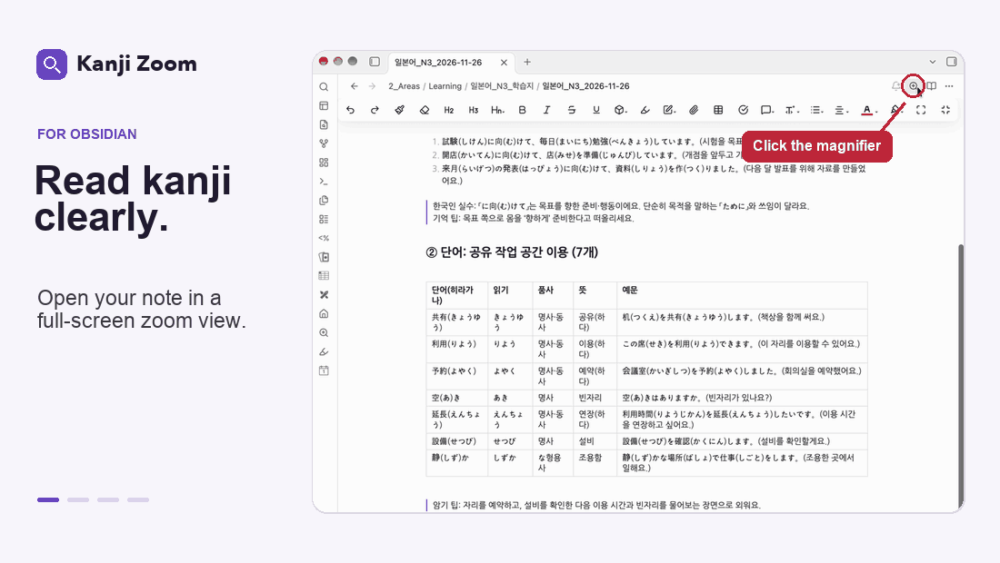

# Kanji Zoom

Read Japanese study notes in Obsidian with larger text, furigana, and offline kanji lookups.

## Install

In Obsidian, go to **Settings → Community plugins → Browse**, search for **Kanji Zoom**, then select **Install** and **Enable**. [View the community listing](https://community.obsidian.md/plugins/kanji-zoom).

Manual installation

1. Download `main.js`, `manifest.json`, and `styles.css` from the [latest release](../../releases/latest).
2. Copy them into `<your vault>/.obsidian/plugins/kanji-zoom/`.
3. Reload Obsidian and enable **Kanji Zoom** under **Settings → Community plugins**.

## Use Kanji Zoom

1. Click the magnifier in the top-right corner of a note to open the full-screen viewer. You can also use the ribbon magnifier or the **Kanji Zoom: Open current note** command. In Reading view, the magnifier next to an H1–H3 heading opens just that section.
2. Drag the **font size** slider to resize text from 18 to 72 px. The viewer remembers your font size, line spacing, and furigana setting.
3. Turn on **Furigana** to display readings such as `参加(さんか)` or `参加（さんか）` above the kanji.
4. Hover over a kanji, or tap it on mobile, to see its readings, meanings, and matching vocabulary from your note.

On desktop, use `+` or `-` to resize text, or hold `Cmd` / `Ctrl` while scrolling. Trackpad pinch also works. Press `Esc` to close the viewer or drag its toolbar to move the window.

## Kanji lookups and languages

The built-in KANJIDIC2 dictionary covers about 3,000 kanji and works offline. The popup shows on and kun readings, meanings, stroke count, school grade, and the legacy JLPT level when available.

Meanings are available in English, French, Spanish, and Portuguese. Kanji Zoom follows Obsidian’s language by default, and you can choose a dictionary language in settings. Missing translations fall back to English. The interface supports English and Korean, and Korean hanja readings are enabled by default when Obsidian is set to Korean.

## Format your study notes

Kanji Zoom finds matching words in vocabulary tables, grammar headings, and inline readings. Use these headers in vocabulary tables.

| Column | Recognised headers |
| --- | --- |
| Word | `단어`, `語`, `word`, `kanji` (otherwise the first column) |
| Reading | `읽기`, `読み`, `reading` |
| Part of speech | `품사`, `品詞`, `pos` |
| Meaning | `뜻`, `의미`, `意味`, `meaning`, `translation` |

Grammar headings like `## 문법: ～を問(と)わず — ~을 따지지 않고` are picked up as `word — meaning`.

See [`samples/`](samples/) for an example note.

## Development

Run `python3 tools/check.py` to build the plugin, check Obsidian compatibility, and run the test suite. Edit `src/main.js` for plugin changes. The build generates `main.js` from the source and dictionary data.

See [CONTRIBUTING.md](CONTRIBUTING.md) for development setup and [PUBLISHING.md](PUBLISHING.md) for the release process.

## Support

If Kanji Zoom helps with your studies, you can [buy me a coffee](https://buymeacoffee.com/kikyung).

## License

- Code: [MIT](LICENSE)
- Kanji data: [KANJIDIC2](https://www.edrdg.org/wiki/index.php/KANJIDIC_Project) © Electronic Dictionary Research and Development Group, used under [CC BY-SA 4.0](https://www.edrdg.org/edrdg/licence.html) — see [data/LICENSE-KANJIDIC2.md](data/LICENSE-KANJIDIC2.md). JLPT levels are the old 4-level ones from KANJIDIC2.
