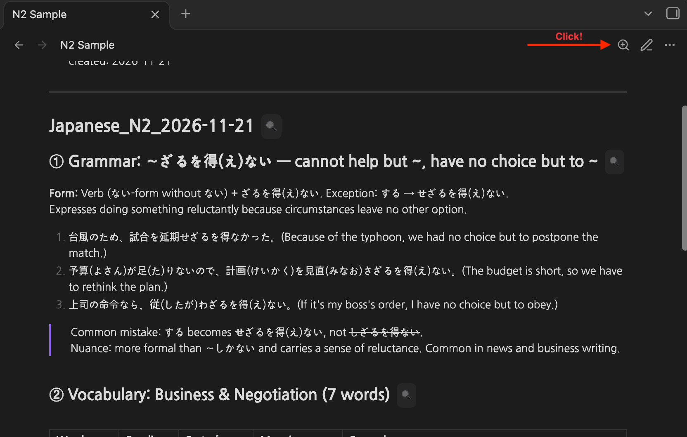
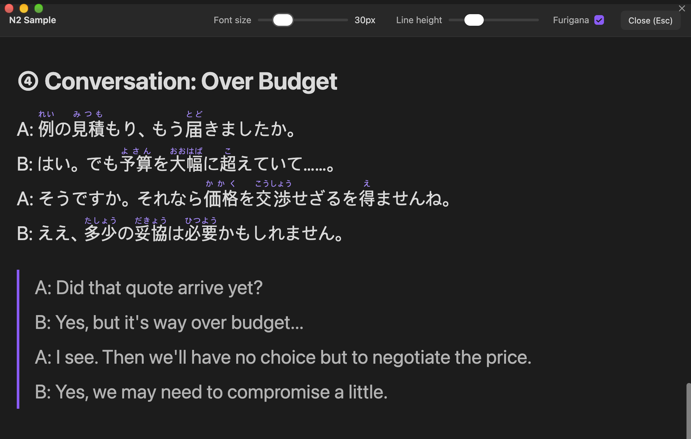
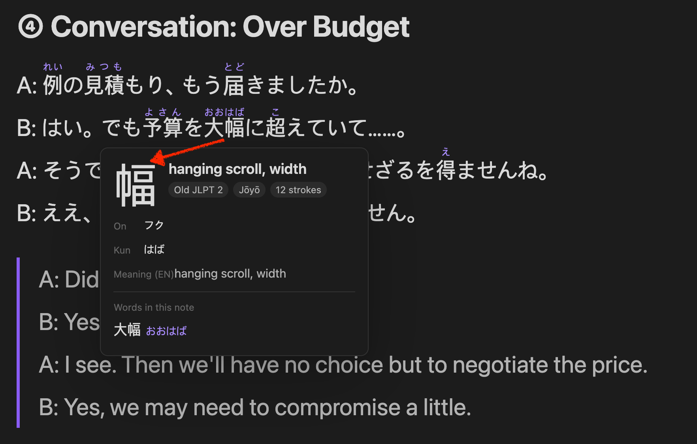

# Kanji Zoom

**Kanji too small to read?** Kanji Zoom opens your Japanese study notes full-screen at up to 72px,
so every stroke is clear — with furigana and kanji hover lookups on top.

[](https://buymeacoffee.com/kikyung)

https://github.com/user-attachments/assets/3414fe81-4e29-4cd0-81a4-2287321b60ea

<table>
  <tr>
    <td align="center" width="33%">
      <br>
      <sub><b>1. Click</b> 🔍 next to the reading/edit toggle</sub>
    </td>
    <td align="center" width="33%">
      <br>
      <sub><b>2. Read big</b> with furigana above every kanji</sub>
    </td>
    <td align="center" width="33%">
      <br>
      <sub><b>3. Hover a kanji</b> for readings, meanings and your note's words</sub>
    </td>
  </tr>
</table>

## Features

- **Zoom viewer** — opens the current note (or one section) full-screen. Font size 18–72px, line height and furigana toggle are remembered.
- **Furigana** — inline readings like `参加(さんか)` or `参加（さんか）` are rendered as ruby text above the kanji.
- **Kanji popup** — hover (or tap on mobile) any kanji to see:
  - On / Kun readings, meanings, stroke count, grade, old JLPT level (KANJIDIC2, ~3,000 kanji, works offline)
  - Meanings in **English, French, Spanish or Portuguese** — follows Obsidian's language or pick one in settings (falls back to English when a kanji has no translation)
  - Optional Korean (hanja) reading — on by default when Obsidian is in Korean
  - **Words in this note** that contain the kanji — pulled from your vocabulary tables, grammar headings and inline readings
- Korean and English UI (follows Obsidian's language).

## How to open

- 🔍 icon in the note's header bar (top right)
- 🔍 ribbon icon
- Command palette: **Kanji Zoom: Open current note** (assign a hotkey if you like)
- Reading view: 🔍 button next to h1–h3 headings opens just that section

Keyboard in the viewer: `+` / `-` font size, `Esc` close.

## Note format tips

Vocabulary tables are detected by header names:

| Column | Recognised headers |
| --- | --- |
| Word | `단어`, `語`, `word`, `kanji` (otherwise the first column) |
| Reading | `읽기`, `読み`, `reading` |
| Part of speech | `품사`, `品詞`, `pos` |
| Meaning | `뜻`, `의미`, `意味`, `meaning`, `translation` |

Grammar headings like `## 문법: ～を問(と)わず — ~을 따지지 않고` are picked up as `word — meaning`.

See [`samples/`](samples/) for an example note.

## Installation

### From Community plugins
Settings → Community plugins → Browse → search **Kanji Zoom**. *(after approval)*

### Manual
1. Download `main.js`, `manifest.json`, `styles.css` from the [latest release](../../releases/latest).
2. Put them in `<your vault>/.obsidian/plugins/kanji-zoom/`.
3. Reload Obsidian and enable **Kanji Zoom** in Settings → Community plugins.

That's it — the kanji dictionary is **built into `main.js`**. Nothing else to download, and it works offline.

## Development

*Only for working on the plugin itself — users don't need any of this.*

No Node.js required.

```bash
python3 tools/check.py          # build + Obsidian compatibility checks + tests (run before every commit)
python3 tools/build.py          # build only: src/main.js + data/kanji.json → main.js
python3 tools/test.py           # tests only (Node.js, or macOS JavaScriptCore if Node isn't installed)
```

Edit `src/main.js`, never `main.js` (it is generated). `tools/check.py` catches common Obsidian review rejections: manifest rules, `innerHTML`, default hotkeys, Node-only `require` on a mobile-enabled plugin, network calls, regex lookbehind (older iOS), and unfinished manifest values in `--release` mode. CI runs it on every push.

Regenerate `data/kanji.json` from the KANJIDIC2 source (maintainers only, e.g. for a new KANJIDIC2 release; the result is committed and embedded at build time):

```bash
curl -LO http://www.edrdg.org/kanjidic/kanjidic2.xml.gz
python3 tools/build_kanji.py kanjidic2.xml.gz data/kanji.json
```

Release: bump `version` in `manifest.json`, add it to `versions.json`, then push a tag with the same version (e.g. `0.1.1`). GitHub Actions builds `main.js` and creates a draft release.

## Support

If this plugin helps your study, you can [buy me a coffee ☕](https://buymeacoffee.com/kikyung).

## License

- Code: [MIT](LICENSE)
- Kanji data: [KANJIDIC2](https://www.edrdg.org/wiki/index.php/KANJIDIC_Project) © Electronic Dictionary Research and Development Group, used under [CC BY-SA 4.0](https://www.edrdg.org/edrdg/licence.html) — see [data/LICENSE-KANJIDIC2.md](data/LICENSE-KANJIDIC2.md). JLPT levels are the old 4-level ones from KANJIDIC2.
